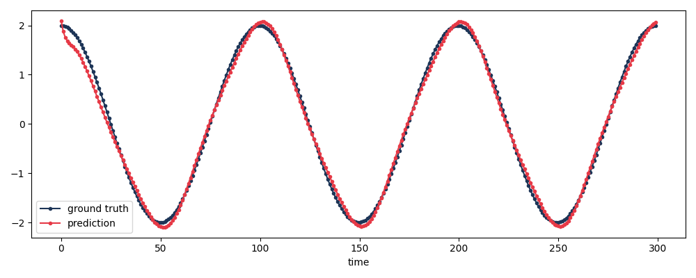

# **pyReCo**

**A Reservoir Computing Library for Time Series Forecasting and Research**

<p align="center">

</p>

**[Official Documentation](https://cyber-physical-systems-in-mech-eng.github.io/pyReCo/index.html)**

pyReCo is built by researchers for researchers: we aim to develop new RC methods that allow for fast and efficient learning for sequential data. The main focus is time series prediction, mostly performed in an auto-regressive fashion based on learning discrete flow maps. Another core aspect that motivates the implementation of a new library is *structure-function-relationships* in functional networks. pyReCo allows to implement novel ways to generate better reservoir networks than the classical random choice.  Overview of the core capabilities of pyReCo:

- [x] **Classical reservoir computing**: using random reservoir layers and training readout-layer weights using Ridge regression
- [x] **Network pruning**: remove edges (or nodes) from the reservoir network one after the other, retrain, and track how the performance and the network properties change
- [x] **Benchmark data sets**: Lorenz-63, Mackey-Glass, NARMA5 and NARMA10, plus simple periodic toy signals
- [x] **Cross-validation**: built-in functions to k-fold cross-validate any pyReCo model for performance evaluation
- [x] **Automated hyper-parameter tuning** for leakage rate, activation function, spectral radius, regularization, etc. (built on [optuna](https://optuna.org))
- [x] **Reproducible**: every random choice is controlled by a `seed`; the global random state is never used
- [ ] **Auto-regressive time stepping** through feeding the predictions into the input layer (closed-loop prediction system). Experimental: see `AutoRC` in the examples, not covered by tests yet.

**Compatibility**: pyReCo follows the syntax of scikit-learn (pyReCo Model-API), such that an estimator has the methods `.fit()` and `.predict()`. Any more experimental modeling can be realised by pyReCo's CustomModel-API, which follows TensorFlow's Sequential-API: a custom pyReCo model is compiled using `model.add()` functions for stacking different layers.  

[](CITATION.cff)

## **Table of Contents**

1. [About the Developers](#about-the-developers)
2. [Installation](#installation)
3. [Usage](#usage)
    - [Model API](#model-api)
    - [CustomModel API](#custommodel-api)
    - [Data shapes and warm-up](#data-shapes-and-warm-up)
    - [Input preprocessing](#input-preprocessing-z-scoring-and-input-scaling)
    - [Initial state and reproducibility](#initial-state-and-reproducibility)
    - [Benchmark data sets](#benchmark-data-sets)
    - [Edge pruning](#edge-pruning)
    - [Hyperparameter tuning](#hyperparameter-tuning)
    - [More examples](#more-examples)
4. [Development and tests](#development-and-tests)
5. [Documentation](#documentation)
6. [Background and Supplementary Material](#background-and-supplementary-material)
7. [Cite pyReCo](#cite-pyreco)

## **About the Developers**

This library is developed by the [Cyber-Physical Systems in Mechanical Engineering (CPSME)](https://www.tu.berlin/cpsme) research group at TU Berlin, led by Prof. Merten Stender. The group specializes in Digital Twins, Dynamics and Artificial Intelligence, and Hybrid Simulation.


## Installation
Simply use pip, or get the source files from this repo.

```
pip install pyreco
```

From a clone of this repository (development version, including the tools to run the tests):

```
pip install -e ".[test]"
```

pyReCo needs Python 3.10 or newer. The comparison of reservoir computers with feed-forward networks in `examples/` needs TensorFlow, which is not installed by default: `pip install pyreco[benchmarks]`.


## Usage

### Model API
The ModelAPI is the simplest way to use one of the predefined RC models for training and prediction. The Model class follows the syntax of scikit-learn, such that an estimator has the methods `.fit()`, `.predict()`, and `.evaluate()`.

The following example illustrates how to translate a sine signal to a cosine signal, i.e. a sequence-to-sequence mapping task. The input is $$x=\sin\left(\pi t\right)$$ and the output is  $$x=2\cos\left(\pi t\right)$$. Thus, The model must learn a phase shift and the amplitude scaling from input to output. Both signals have 3 periods, sampled with 100 steps per period.

```python
import numpy as np
from matplotlib import pyplot as plt
from pyreco.models import ReservoirComputer as RC

# generate 3 cycles of a sine (input) and of a cosine (output)
omega = np.pi
t = np.linspace(start=0, stop=3 * (2*np.pi/omega), num=300, endpoint=True)
x = np.sin(omega * t)
y = 2 * np.cos(omega * t)

x_train = np.expand_dims(x, axis=(0,2))  # obtain shape of [n_batch, n_time, n_states]
y_train = np.expand_dims(y, axis=(0,2))

# fit a reservoir computer with 200 nodes and make predictions on the training set
model = RC(num_nodes=200, activation='tanh')
model.fit(x_train, y_train)
y_pred = model.predict(x_train)

# evaluate some metrics (for simplicity on the train set)
metric_value = model.evaluate(x=x_train, y=y_train, metrics=['mse','mae'])
print(f'scores:{metric_value}')

# print truth and predicted sequence
plt.figure()
plt.plot(y_train[0,:,0], label='ground truth', marker='.', color='#1D3557')
plt.plot(y_pred[0,:,0], label='prediction', marker='.', color='#E63946')
plt.legend()
plt.xlabel('time')
plt.show()

```
Plotting `y_pred` and `y_train` against the time vector `t` shows how the minimal RC can learn a phase shift, i.e. translate a sine signal to a cosine signal, and also scale the output to the correct amplitude. You may want to increase the reservoir size (`num_nodes`) or change the leakage rate (`leakage_rate`) to improve the prediction quality.  



### CustomModel API

The `CustomModel` API gives the user more flexibility in defining specific properties. For example, one can specify the fraction of reservoir nodes which receive the inputs. Additionally, the user can provide custom reservoir layers and add them to the model. The same example as for the Model API can be obtained with the custom model, as shown below. 

```python
import numpy as np
from matplotlib import pyplot as plt

from pyreco.custom_models import RC
from pyreco.layers import InputLayer, ReadoutLayer
from pyreco.layers import RandomReservoirLayer

# generate 3 cycles of a sine (input) and of a cosine (output)
omega = np.pi
t = np.linspace(start=0, stop=3 * (2*np.pi/omega), num=300, endpoint=True)
x = np.sin(omega * t)
y = 2 * np.cos(omega * t)

x_train = np.expand_dims(x, axis=(0,2))  # obtain shape of [n_batch, n_time, n_states]
y_train = np.expand_dims(y, axis=(0,2))

# set the dimensions
input_shape = (x_train.shape[1], x_train.shape[2])
output_shape = (y_train.shape[1], y_train.shape[2])

# build a custom RC model by adding layers with properties
model = RC()
model.add(InputLayer(input_shape=input_shape))
model.add(RandomReservoirLayer(nodes=200, activation='tanh', fraction_input=0.5))
model.add(ReadoutLayer(output_shape))

# compile the model
model.compile(optimizer='ridge', metrics=['mean_squared_error'])

# train the model
model.fit(x_train, y_train)

# make predictions
y_pred = model.predict(x_train)
print(f'shape of predicted array: {y_pred.shape}')

# evaluate some metrics (for simplicity on the train set)
metric_value = model.evaluate(x=x_train, y=y_train, metrics=['mse','mae'])
print(f'scores:{metric_value}')
```

The available metrics are `mse`, `mae`, `rmse`, `nrmse` (the RMSE divided by the standard deviation of the target: 1 for predicting the mean, 0 for a perfect prediction) and `r2`; all of them are computed per output channel and averaged. The readout is trained with Ridge regression (`optimizer='ridge'`) and includes an intercept; its regularization strength is a hyperparameter: `model.set_hp(alpha=1e-6)`.


### Data shapes and warm-up

The shape of the data is of utmost importance. pyReCo is built for sequential modeling tasks. Make sure to provide the data in the shape of `[n_batch, n_time, n_states]`, where
- `n_batch` is the number of samples, i.e. the number of individual time series samples (example above: `n_batch = 1`)
- `n_time` is the number of time steps per sample (example above: `n_time = 300`)
- `n_states` is the channel dimension, i.e. the number of contemporaneous states in the time series (example above: `n_states = 1`)

The inputs and the targets may differ in the number of time steps and in the number of states, e.g. one target for a whole input sequence (*sequence to scalar*) or 3 input states for 2 target states. `examples/mwe_task_shapes.py` shows the common cases.

Every sample is a fresh run of the reservoir from its initial state, so the first reservoir states still depend on that initial state. The **warm-up** `discard_transients` (an argument of `compile()`, default 0) skips them: the target at time step `j` is paired with the reservoir state after the inputs `0, ..., d + j` have been applied, `d` being the warm-up. The warm-up must not exceed the number of input time steps minus the number of target time steps, so provide inputs that are longer than the targets. For a sequence-to-scalar task with `T` input steps use `discard_transients = T - 1`: the target is then paired with the last state, which has seen the whole input sequence.


### Input preprocessing (z-scoring and input scaling)

With the `CustomModel` API, `fit()` standardizes every input channel by *z-scoring* it, i.e. subtracting its mean and dividing by its standard deviation (statistics are computed over all batches and time steps of the training data and reused in `predict()`). The z-scored inputs are then multiplied by `input_scaling`, a positive gain (scalar or one value per channel, default `1.0`). The gain is equivalent to scaling the columns of the read-in matrix `W_in` and controls how nonlinear the reservoir responds. Both are set in `compile()`:

```python
model.compile(optimizer='ridge', normalize_inputs=True, input_scaling=1.0)  # these are the defaults
```

The targets are **not** transformed: predictions are returned in the units of `y`.


### Signed weights and the input bias

By default all edges of a `RandomReservoirLayer` have the same, positive weight (a binary Erdős-Rényi graph that is scaled to the spectral radius). Many echo state networks use random weights of both signs, which helps on tasks with nonlinear memory such as NARMA10. `weight_distribution` draws the weight of every existing edge after the graph, so the graph itself is the same for all choices: `'positive'` (default), `'sign'` (+1 or -1), `'uniform'` (on [-1, 1]) or `'normal'`. The read-in weights have the same option in `InputLayer(weight_distribution='normal' | 'uniform' | 'sign')`.

`compile(input_bias=b)` adds a constant input to every reservoir node, `b` times a fixed random sign per node (default `0`, no bias). Without a bias, and with the zero-mean inputs of the z-scoring, the states of a `tanh` reservoir are odd functions of the input, so even functions such as `x**2` cannot be learned. The bias, like `input_scaling`, can be tuned as a hyperparameter (`model.set_hp(input_bias=0.5)`).

```python
import numpy as np

from pyreco.custom_models import RC
from pyreco.layers import InputLayer, RandomReservoirLayer, ReadoutLayer

# learn y = x^2, an even function of the input
rng = np.random.default_rng(0)
x = rng.uniform(-1, 1, size=(20, 60, 1))
y = x**2

model = RC(seed=1)
model.add(InputLayer(input_shape=x.shape[1:], weight_distribution='sign'))
model.add(RandomReservoirLayer(nodes=30, density=0.2, seed=1, weight_distribution='uniform'))
model.add(ReadoutLayer(y.shape[1:]))
model.compile(normalize_inputs=False, input_bias=1.0)
model.fit(x, y)
print(f'scores:{model.evaluate(x, y, metrics=["nrmse"])}')  # NRMSE 1 = predicting the mean
```


### Initial state and reproducibility

The reservoir starts every sample from the zero state. Other initial states can be requested with `RandomReservoirLayer(init_res_sampling='ones' | 'random' | 'random_normal')`, or set explicitly after compiling the model with `model.reservoir_layer.set_initial_state(r0)`.

All random choices are controlled by seeds, the global random state (`np.random`, `random`) is neither used nor changed. `RandomReservoirLayer(seed=...)` fixes the reservoir network; `RC(seed=...)` fixes the read-in weights, the initial state and the choice of input and readout nodes. The data generators, `cross_val` and `EdgePruner` take a `seed` as well.


### Benchmark data sets

`pyreco.datasets.load` generates time series of standard benchmark systems and cuts them into training and test windows (chronological split):

| name | system | states | task |
|---|---|---|---|
| `lorenz` | Lorenz-63 attractor (chaotic) | 3 | forecast the next values |
| `mackey_glass` | Mackey-Glass delay equation (chaotic) | 1 | forecast the next values |
| `narma5`, `narma10` | nonlinear autoregressive moving-average system of order 5 / 10 | 1 | map a random input to the system output (memory and nonlinearity) |

```python
from pyreco.custom_models import RC
from pyreco.datasets import load
from pyreco.layers import InputLayer, RandomReservoirLayer, ReadoutLayer

# windows of 30 values of the Lorenz system (3 states) -> the next value
x_train, y_train, x_test, y_test, scaler = load('lorenz', n_samples=2500, n_in=30, n_out=1, standardize=True)

model = RC(seed=0)
model.add(InputLayer(input_shape=x_train.shape[1:]))
model.add(RandomReservoirLayer(nodes=200, leakage_rate=0.5, seed=0))
model.add(ReadoutLayer(output_shape=y_train.shape[1:]))
model.compile(discard_transients=29)  # warm-up: only the last state of a window is paired with the target
model.fit(x_train, y_train)

print(f"scores: {model.evaluate(x_test, y_test, metrics=['nrmse'])}")  # 1 = predicting the mean
```

Simple periodic signals (a sine with a different frequency per state, sine to cosine, ...) for quick tests are in `pyreco.utils_data`.


### Edge pruning

The reservoir network can be thinned out: `EdgePruner` removes edges one after the other. In every iteration, a fraction of the edges are candidates; each candidate is removed tentatively, the readout is retrained, and the removal that hurts the validation performance least is kept. The history records the performance and the properties of the network (density, spectral radius, degrees, ...) during pruning. Nodes can be removed as well with `NetworkPruner`.

```python
import numpy as np
from pyreco.custom_models import RC
from pyreco.edge_pruning import EdgePruner
from pyreco.layers import InputLayer, RandomReservoirLayer, ReadoutLayer
from pyreco.utils_data import sequence_to_sequence

# sine prediction data and a fitted reservoir computer with 20 nodes
X_train, X_test, y_train, y_test = sequence_to_sequence('sine_pred', n_batch=60, n_states=2, n_time=20, seed=0)
model = RC(seed=0)
model.add(InputLayer(input_shape=X_train.shape[1:]))
model.add(RandomReservoirLayer(nodes=20, density=0.15, seed=0))
model.add(ReadoutLayer(output_shape=y_train.shape[1:]))
model.compile()
model.fit(X_train, y_train)

# remove 6 edges, 20% of the edges are candidates in every iteration
n_edges = int(np.count_nonzero(model.reservoir_layer.weights))
pruner = EdgePruner(candidate_fraction=0.2, stopping_criterion=['min_edges'], min_num_edges=n_edges - 6, seed=0)
pruned_model, history = pruner.prune(model, (X_train, y_train), (X_test, y_test))

print(f"edges: {n_edges} -> {int(np.count_nonzero(pruned_model.reservoir_layer.weights))}")
print(f"scores (test MSE before/after): {model.evaluate(X_test, y_test)[0]:.4f} / {pruned_model.evaluate(X_test, y_test)[0]:.4f}")
```

Edges are directed: `weights[u, v]` is the edge from node `u` to node `v`. Note that pruning can remove the last directed cycle of the network: its spectral radius is then 0 and it cannot be rescaled to a target spectral radius anymore (the pruner warns once if this happens).


### Hyperparameter tuning

`Tuner` searches hyperparameters of a compiled model with [optuna](https://optuna.org): the spectral radius, the leakage rate, the activation function, the input scaling and the regularization strength of the readout. Your model is not modified: the trials run on copies, and the best one is `tuner.best_model`. With a `seed` the search is reproducible; the tuner is quiet unless `verbose=True`.

```python
from pyreco.custom_models import RC
from pyreco.layers import InputLayer, RandomReservoirLayer, ReadoutLayer
from pyreco.tuner import Tuner
from pyreco.utils_data import sequence_to_sequence

X_train, X_test, y_train, y_test = sequence_to_sequence('sine_pred', n_batch=60, n_states=1, n_time=20, seed=0)
model = RC(seed=0)
model.add(InputLayer(input_shape=X_train.shape[1:]))
model.add(RandomReservoirLayer(nodes=50, seed=0))
model.add(ReadoutLayer(output_shape=y_train.shape[1:]))
model.compile()

search_space = {
    'spec_rad': ('float', 0.3, 1.0),
    'leakage_rate': ('float', 0.1, 1.0),
    'activation': ('categorical', ['tanh', 'sigmoid']),
    'input_scaling': ('float', 0.1, 3.0),
    'alpha': ('float', 1e-8, 1.0, 'log'),  # strength of the ridge regularization of the readout
}
tuner = Tuner(model, search_space, X_train, y_train, x_val=X_test, y_val=y_test, n_trials=10, seed=0)
tuner.optimize()
tuner.report()
print(f"scores: {tuner.best_model.evaluate(X_test, y_test)}")  # the tuned model
```


### More examples

The folder `examples/` contains minimal working examples (`mwe_*.py`) that you can run directly:

| script | topic |
|---|---|
| `mwe_model_api.py`, `mwe_custom_model_api.py` | the two APIs (sine to cosine) |
| `mwe_task_shapes.py` | shapes of inputs and targets, warm-up |
| `mwe_chaotic_datasets.py`, `mwe_narma.py` | Lorenz, Mackey-Glass and NARMA benchmarks |
| `mwe_cross_validation.py` | k-fold cross-validation, drawing the reservoir network |
| `mwe_hyperparameter_tuning.py` | hyperparameter search with `Tuner` |
| `mwe_narma10_size_sweep_edge_pruning.py` | NARMA10: how many nodes are needed (size sweep with tuned hyperparameters), then how many edges (edge pruning); also an extended smoke test that reports unexpected behavior |
| `mwe_set_readin_weights.py`, `setting_reservoir_matrix.py` | use your own read-in weights or reservoir matrix |
| `mwe_remove_nodes.py`, `mwe_remove_edges.py` | remove nodes or edges of a trained model |
| `mwe_node_pruning.py`, `mwe_edge_pruning.py` | pruning |
| `mwe_lorenz_reconstruction.py` | Reconstruct the third Lorenz state from the first two (reservoir observer), with controls that must fail |
| `mwe_narma10_optimal_reservoir.py` | NARMA10: search for the best reservoir with at most 200 nodes (size, density and hyperparameters) |
| `effects_network_structure.py` | variation of the performance across random reservoir networks |
| `compare_tensorflow_recopy.py`, `RC_vs_ANN.py` | comparison with feed-forward networks (needs `pyreco[benchmarks]`) |
| `testing_autoRC.py`, `testing_Hybrid-RC.py` | experimental closed-loop (auto-regressive) prediction |


## Development and tests

```
pip install -e ".[test]"
pytest
```

The tests run on every pull request (GitHub Actions, `.github/workflows/tests.yml`). The test suite includes accuracy checks on the benchmark systems and tests that run the code examples of this README. Please add a line to `CHANGELOG.md` for every change that users notice; see also [CONTRIBUTING](CONTRIBUTING.rst).


## Documentation

The official pyReCo documentation can be found here: **[Official Documentation](https://cyber-physical-systems-in-mech-eng.github.io/pyReCo/index.html)**.


## Background and Supplementary Material

### Introductory material to reservoir computing and echo state networks
- [Cucchi 2022: Hands-on Reservoir Computing](https://iopscience.iop.org/article/10.1088/2634-4386/ac7db7)
- [Gallichio: An Introduction to Reservoir Computing](http://didawiki.cli.di.unipi.it/lib/exe/fetch.php/magistraleinformatica/aa2/rnn4-esn.pdf)
- [Lukoševičius 2012: A Practical Guide to Applying Echo State Networks](https://www.ai.rug.nl/minds/uploads/PracticalESN.pdf)

### Other RC libraries that you may want to have a look at
- [reservoirpy](https://github.com/reservoirpy/reservoirpy)
- [PYRCN](https://github.com/TUD-STKS/PyRCN/)
- [EchoTorch](https://github.com/nschaetti/EchoTorch)
- [list of more packages](https://github.com/topics/reservoir-computing)


## Cite pyReCo

[](CITATION.cff)

If you use pyReCo in your research, please cite it. GitHub's "Cite this repository" button (in the sidebar) uses the metadata in [`CITATION.cff`](CITATION.cff).

**BibTeX**

```bibtex
@software{pyreco,
  title   = {pyReCo: A Python Reservoir Computing Library for Time Series Forecasting and Research},
  author  = {Yadav, Manish and Disson, Klara and Stender, Merten},
  version = {2.1.0},
  year    = {2026},
  license = {Apache-2.0},
  url     = {https://github.com/Cyber-Physical-Systems-in-Mech-Eng/pyReCo}
}
```

**APA**

Yadav, M., Disson, K., & Stender, M. (2026). *pyReCo: A Python reservoir computing library for time series forecasting and research* (Version 2.1.0) [Computer software]. Technische Universität Berlin. https://github.com/Cyber-Physical-Systems-in-Mech-Eng/pyReCo
